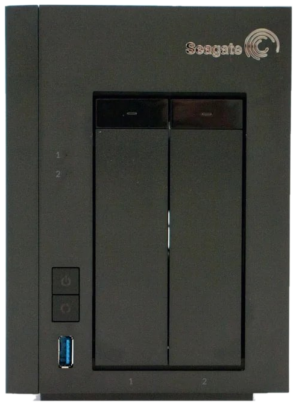
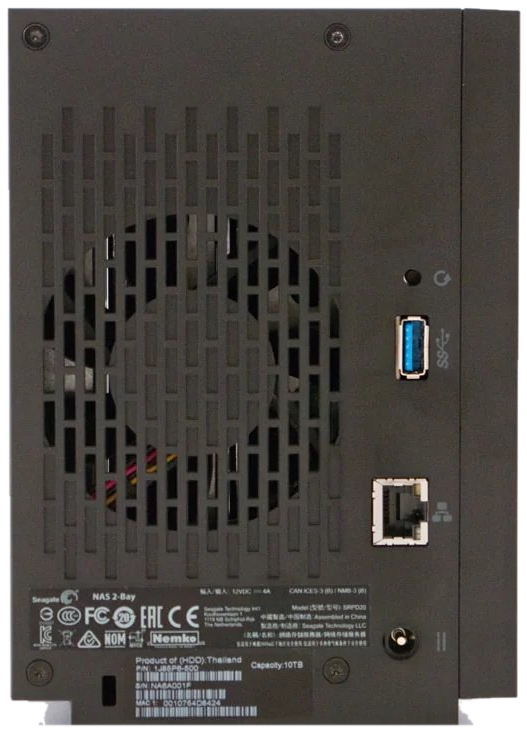
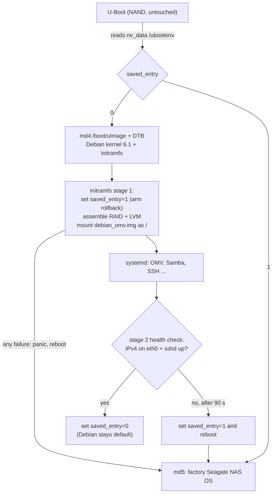

# Debian 12 + OpenMediaVault 7 for the Seagate NAS 2-Bay (SRPD20 / n090201)

Run a **current, maintained Debian 12 (bookworm) with OpenMediaVault 7** on the discontinued
**Seagate NAS 2-Bay**, installed **from the factory NAS OS over SSH** — no NAND flashing,
no data loss, and an automatic fallback to the factory firmware if anything goes wrong.

Includes native OMV 7 plugins for the hardware that stock Debian does not know about:
fan curve, all six chassis LEDs, the three chassis buttons, One-Touch USB backup and an
interactive hardware dashboard widget (English + Turkish).

<p align="center">
  
  &nbsp;&nbsp;
  
</p>

> [!WARNING]
> This is a community project, not supported by Seagate or OpenMediaVault. It has been
> developed and tested on **one** unit (2 × 4 TB, RAID 1). Back up important data before
> installing. A 3.3 V USB-UART adapter is strongly recommended for recovery.

---

## Contents

- [Hardware](#hardware)
- [Why replace the stock firmware?](#why-replace-the-stock-firmware)
- [What you get](#what-you-get)
- [How it boots](#how-it-boots)
- [Installation](#installation)
- [After installation](#after-installation)
- [Switching between Debian and the factory OS](#switching-between-debian-and-the-factory-os)
- [UART recovery console](#uart-recovery-console)
- [Plugins](#plugins)
- [Building from source](#building-from-source)
- [Known limitations](#known-limitations)
- [Repository layout](#repository-layout)
- [License](#license)

---

## Hardware

| Component | Details |
| :--- | :--- |
| Model | Seagate NAS 2-Bay, model **SRPD20**, board **n090201** ("Dart 2-Bay") |
| SoC | Marvell **Armada 370** (88F6710), 1 × ARMv7 core @ 1.2 GHz, VFPv3 |
| RAM | 512 MB DDR3 |
| Flash | 256 MB NAND (U-Boot 2011.12 Seagate 4.0.15, device tree, NAND rescue system) |
| Storage | 2 × SATA II (3 Gb/s, `sata_mv`), hot-swap trays |
| Network | 1 × Gigabit Ethernet (`mvneta`) |
| USB | 2 × USB 3.0 (front + rear) on an ASMedia ASM1042A PCIe controller |
| Cooling | 1 × chassis fan, 4 speeds via `gpio-fan` (0 / 950 / 1400 / 1800 RPM) |
| LEDs | 6: power white/red, disk 1 white/red, disk 2 white/red |
| Buttons | Front **Power**, front **Sync/Backup**, rear **Reset** (pinhole) |
| Other | I²C RTC (MCP7941x), Orion hardware watchdog, 2 × Marvell XOR/DMA engines, thermal sensor |
| Stock OS | Seagate NAS OS 4.2.12 — Linux 3.10.72 (2016), no longer updated |

Factory disk layout (identical on both disks, mdadm metadata 1.0) — this project keeps it as is:

| Partition | RAID | Size | Use |
| :--- | :--- | :--- | :--- |
| sdX2 | – | 192 MB | `boot_rescue` |
| sdX3 | – | 1 MB | `nv_data` – U-Boot boot selector file `/ubootenv` |
| sdX4 | md4 | 1.5 GB | `root_1` – **boot slot 0** → Debian uImage + DTB are placed in `/boot` |
| sdX5 | md5 | 1.5 GB | `root_2` – **boot slot 1** → factory NAS OS (untouched) |
| sdX6 | md6 | 1 GB | factory `/var` |
| sdX7 | md7 | 512 MB | swap (reused by Debian) |
| sdX8 | md8 | rest | LVM `vg/lv`, ext4 – **your data** + `debian_omv.img` |

---

## Why replace the stock firmware?

| | Stock Seagate NAS OS 4.2.12 | This project |
| :--- | :--- | :--- |
| Kernel | Linux 3.10.72 (2016, EOL) | Debian 12 Linux **6.1 LTS** |
| Security updates | none (product discontinued) | Debian security + OMV updates via `apt` |
| Web UI | Seagate NAS OS | **OpenMediaVault 7** (Sandworm) |
| File sharing | old Samba / AFP | Samba 4.17 (SMB2/SMB3), NFS, rsync, SSH/SFTP |
| RAM in use at idle | ≈ 250 MB | ≈ 105 MB with OMV running (≈ 60 MB plain Debian) |
| USB 3.0 controller | yes | yes (PCIe enabled and fixed in the device tree) |
| Fan control | fixed firmware logic | configurable curve or fixed speed from the web UI |
| LEDs / buttons | fixed functions | every LED and button configurable (short / long press) |
| Package ecosystem | none | full Debian armhf archive |
| Recovery | NAND rescue | NAND rescue **plus** automatic fallback to the factory OS |

Technical improvements over a naive Debian install:

- **Mainline device tree fixes** for this board: SATA clock gating (`sa-sram@400/@600`),
  `clock-names`, MBus SRAM window, PMSU/CESA idle hang avoided, USB 3.0 PCIe, white
  disk LEDs (`mpp48`/`mpp57`) muxed to GPIO so they can actually be switched off.
- **Marvell XOR engines** (`mv_xor`) offload RAID 1 resync/copy work from the single CPU core.
- **Hardware watchdog** active under systemd — a hung box resets itself.
- RAM-tuned OMV: PHP-FPM `ondemand`, collectd/rrdcached/monit/postfix/avahi masked.

> Throughput benchmarks (SMB/NFS) have not been published yet — contributions welcome.

---

## What you get

- Debian 12 armhf + OpenMediaVault 7, root filesystem in a **single image file**
  (`debian_omv.img`, grown to 32 GB by default) on your existing data volume.
- Package **`seagate-nas2bay-boot`** – device tree, uImage builder, kernel hook, initramfs
  with fail-safe logic, `nas-boot-select`, first-boot setup, boot health check.
- Package **`openmediavault-seagate-nas2bay`** – the OMV plugins and dashboard widget.

---

## How it boots

The stock U-Boot (left untouched in NAND) reads `/ubootenv` from the `nv_data` partition:
`saved_entry=0` boots `root_1` (md4), `saved_entry=1` boots `root_2` (md5, factory OS),
and after 3 failed attempts (`boot_count >= 3`) it starts the NAND rescue system.
U-Boot runs `bootm 0x2000000 - 0x6000000` and never loads a separate initrd, so the
Debian zImage is padded to 16 MiB and the initramfs is appended at `0x3000000`; the DTB
`/chosen` node tells the kernel where it is.



---

## Installation

### Requirements

- Seagate NAS 2-Bay running the factory **NAS OS 4.x** with a **data volume created**
  (RAID 1 tested; both disks recommended).
- At least **34 GB free** on the data volume (32 GB root image + temporary space).
- SSH access to the NAS (enable SSH in the NAS OS web interface).
- Optional but recommended: a 3.3 V USB-UART adapter, see [UART recovery console](#uart-recovery-console).

> [!IMPORTANT]
> Do **not** run a factory firmware update after installing — NAS OS updates write to the
> inactive slot (`root_1` / md4), which now holds the Debian boot files.

### Steps

1. Download the assets of the [latest release](https://github.com/laserbirdx/seagate-nas2bay-omv/releases):
   `seagate-nas2bay-omv7-rootfs-<ver>.img.gz`, `seagate-nas2bay-omv7-boot-<ver>.tar.gz`,
   `install-from-stock.sh` and `SHA256SUMS`.
2. Copy all four files into a share on the NAS, e.g. **Public**, using your file manager (SMB).
3. Log in over SSH and become root:
   ```sh
   ssh admin@<nas-ip>
   sudo -i            # or: su
   ```
4. Go to the folder with the files (on NAS OS shares are under `/shares/<ShareName>`) and do a dry run:
   ```sh
   cd /shares/Public
   sh install-from-stock.sh --dry-run
   ```
5. Install. You will be asked to type `YES` and to choose the password for `root` and the
   OMV web `admin` user:
   ```sh
   sh install-from-stock.sh
   ```
   Options: `--size 64` (root image size in GB), `--password ...`, `--yes`.
6. Reboot the NAS. The first boot takes 2–4 minutes (SSH keys are generated and the root
   image is grown to its final size).
7. Open `http://<nas-ip>/` and log in as **admin** with your password.
   SSH: `ssh root@<nas-ip>`.

If Debian does not come up, the NAS returns to the factory OS by itself. Look at
`debian_initramfs.log` and `seagate-omv-firstboot.log` in the root of the data volume.

---

## After installation

1. **Shared folders** – the data volume is already mounted at `/media/internal_1`
   (OMV: *Storage → File Systems*). The factory OS keeps each share in
   `shares/<N>/data/`. In *Storage → Shared Folders* create a shared folder per share and
   point its relative path to the matching `shares/<N>/data/` directory, then enable it under
   *Services → SMB/CIFS → Shares*.
2. **Users** – add users under *Users*. Samba passwords are set whenever you set a
   user's password in OMV.
3. **Plugins** – configure *Services → Fan & Thermal*, *LED & Night Mode* and
   *Chassis Buttons*; add the *Hardware Overview* widget on the dashboard.
4. **Updates** – `apt update && apt full-upgrade` or *System → Update Management*.
   The uImage is rebuilt automatically when a matching kernel is installed.

---

## Switching between Debian and the factory OS

From Debian:

```sh
nas-boot-select status      # show the current U-Boot selection
nas-boot-select factory     # boot the factory NAS OS next time
reboot
```

From the factory OS (Debian files are still on disk):

```sh
sh install-from-stock.sh --boot-debian   # select Debian again
reboot
```

Complete removal (from the factory OS): `sh install-from-stock.sh --uninstall` restores the
original slot-0 boot files from `seagate-omv-backup/` and selects the factory OS. Then delete
`debian_omv.img` from the data volume.

---

## UART recovery console

The serial console gives access to U-Boot and the kernel log even when the network is down.

- Use a **3.3 V** USB-UART adapter (CP2102, CH340, FT232). **Never connect VCC.**
- Settings: **115200 baud, 8N1**, no flow control.
- Wiring: adapter GND → board GND, adapter RX → board TX, adapter TX → board RX.
- See [docs/UART.md](docs/UART.md) for the header location and more U-Boot commands.

Stop autoboot by pressing a key during `Hit any key to stop autoboot: 3` to get the
`Marvell>>` prompt. The disks are `ide 0` and `ide 1`; partition 3 holds `/ubootenv`.

Force the **factory OS**:

```
Marvell>> ext2set ide 0:3 /ubootenv saved_entry 1
Marvell>> ext2set ide 1:3 /ubootenv saved_entry 1
Marvell>> ext2set ide 0:3 /ubootenv boot_count 0
Marvell>> ext2set ide 1:3 /ubootenv boot_count 0
Marvell>> reset
```

Use `saved_entry 0` instead to force **Debian**. One-time boot of the **previous** Debian
image (`seagate-mkuimage` keeps it as `*.prev`):

```
Marvell>> ext2load ide 1:4 0x06000000 /boot/armada-370-n090201.dtb.prev
Marvell>> ext2load ide 1:4 0x02000000 /boot/uImage.prev
Marvell>> setenv bootargs console=ttyS0,115200 panic=10
Marvell>> bootm 0x02000000 - 0x06000000
```

Debian prints its boot log and a login prompt on the same serial port.

---

## Plugins

All plugins are native OMV 7 pages (no separate web server), use the OMV theme and
are translated to English and Turkish.

### Fan & Thermal — *Services → Fan & Thermal*
- Automatic mode: CPU temperature thresholds for 950 / 1400 / 1800 RPM, fan off when cool.
- Manual mode: fixed speed.
- Live telemetry: fan RPM, CPU and Ethernet PHY temperature, disk temperatures.

### LED & Night Mode — *Services → LED & Night Mode*
- Presets: normal, all off (stealth), night, custom per LED (on, off, heartbeat, disk activity, blink).
- Hourly sleep schedule (e.g. LEDs off 23:00–07:00).
- **Turn Off All LEDs** and **Restore LED Defaults** quick buttons.
- Note: the white light behind the Sync button is hard-wired to the power rail and cannot be switched.

### Chassis Buttons — *Services → Chassis Buttons*
Short and long press (2/3/5 s) actions for **Sync**, **Power** and **Reset**:
toggle stealth mode, One-Touch USB backup, unmount USB drives, fan turbo, restart Samba,
restart networking, reboot, power off, or nothing.

**One-Touch USB Backup:** destination shared folder and sub-folder, new folder per run
(prefix + timestamp + suffix) or one fixed folder, LED pattern while copying and when done
(red flashes on error), and what to do afterwards (eject USB, keep mounted, LEDs off,
power off, reboot). A *Run USB Backup Now* button starts it from the web UI.

### Hardware Overview dashboard widget
Front and rear photos of the NAS with hover zones: disk bays (model, serial, capacity,
temperature, SMART), fan (RPM, mode), USB ports (device name, size, speed), Ethernet
(IP, MAC, live traffic) and power/LED state.

---

## Building from source

Build the packages (any Debian/Ubuntu machine or WSL):

```sh
sh tools/build-debs.sh          # -> dist/*.deb
```

Install or upgrade them on a running system:

```sh
apt install ./seagate-nas2bay-boot_*_armhf.deb ./openmediavault-seagate-nas2bay_*_all.deb
```

Create the release assets from a working NAS (sanitizes passwords, SSH host keys, shares,
Samba secrets, logs and machine-id; rebuilds a generic initramfs/uImage):

```sh
sh tools/export-rootfs.sh 1.0.0 installer/install-from-stock.sh
# -> /media/internal_1/.rootfs-export/out/
```

---

## Known limitations

- **Kernel**: only Debian 12 **6.1 LTS** kernels are packed into the uImage
  (`KERNEL_PATTERN` in `/etc/default/seagate-nas2bay-boot`). Newer backports kernels are untested.
- **Wake-on-LAN** is not possible: power-off cuts the 3.3 V rail of the Ethernet PHY (`gpio-poweroff`).
- **Hardware crypto (CESA)** stays disabled — it is disabled in the factory device tree as well
  and causes idle hangs with mainline kernels.
- Tested on one unit with 2 × Seagate ST4000DM004 in RAID 1. Single-disk and JBOD setups
  should work but are untested.
- 512 MB RAM: Docker and heavy OMV plugins are not recommended.

---

## Repository layout

```
installer/install-from-stock.sh            installer for the factory NAS OS (busybox sh)
packages/seagate-nas2bay-boot/              boot support package (DTB, initramfs, uImage, fail-safe)
packages/openmediavault-seagate-nas2bay/    OMV 7 plugins + dashboard widget + hardware daemon
tools/build-debs.sh                         build both .deb packages
tools/export-rootfs.sh                      build sanitized release image from a working NAS
docs/UART.md                                serial console and U-Boot reference
```

## License

[GPL-3.0](LICENSE). OpenMediaVault is © Volker Theile, Debian is © the Debian project;
Seagate is a trademark of Seagate Technology LLC. This project is not affiliated with them.
