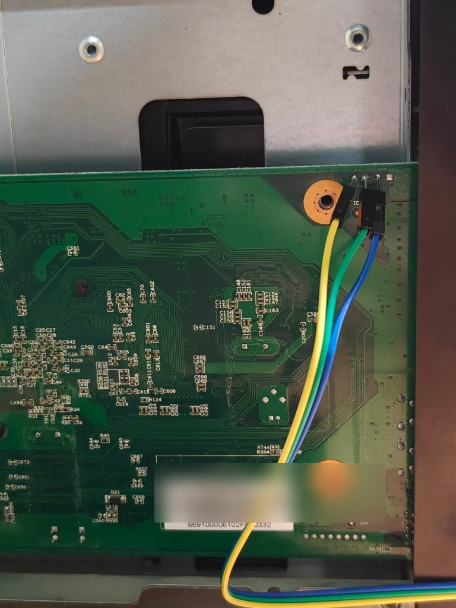

# UART serial console & U-Boot reference

The Seagate NAS 2-Bay exposes the SoC's first UART (`ttyS0`) on a small header on the
mainboard. With it you can watch the complete boot, stop U-Boot and repair a system that
does not reach the network.

## Adapter and settings

| | |
| :--- | :--- |
| Level | **3.3 V TTL** — 5 V or RS-232 adapters can damage the board |
| Baud rate | **115200**, 8 data bits, no parity, 1 stop bit (8N1) |
| Flow control | none |
| Wiring | GND–GND, adapter RX ← board TX, adapter TX → board RX, **do not connect VCC** |

Terminal programs: PuTTY / KiTTY (Windows), `picocom -b 115200 /dev/ttyUSB0`,
`screen /dev/ttyUSB0 115200` (Linux/macOS).

## Header location & pinout

The 4-pin UART header is located at the top-right corner of the mainboard (when viewed with the SATA backplane facing up), reachable after sliding the metal chassis cover off.

<p align="center">
  
</p>

### Pinout (from left to right in the photo)

| Pin | Wire Color (Photo) | Signal | Connection to USB-UART Adapter |
| :---: | :---: | :---: | :--- |
| **1** | **Yellow** | **GND** | Connect to USB-UART **GND** |
| **2** | **Green** | **TX** | Connect to USB-UART **RX** (Board transmits to PC) |
| **3** | **Blue** | **RX** | Connect to USB-UART **TX** (Board receives from PC) |
| **4** | *(Unconnected)* | **VCC (3.3V)** | **DO NOT CONNECT** (Powering the board externally can damage the SoC) |

> [!WARNING]
> Use a **3.3 V TTL** USB-UART adapter only (FT232RL, CP2102, CH340G set to 3.3 V). Never connect the 5 V or 3.3 V VCC pin from the adapter to the board — the board is already powered by its internal 12 V/5 V/3.3 V regulators.

## Boot sequence on the console

```
BootROM 1.08
Booting from NAND flash
...
U-Boot 2011.12-svn1537 (Nov 21 2014 - 10:27:52) Marvell version: v2011.12 2013_Q2.1 - Seagate version: 4.0.15
Board: Dart
SoC:   MV6710 A1
DRAM:  512 MiB
Hit any key to stop autoboot:  3
Model: ST4000DM004-2CV104 ...
Booting Nexus OS from disk ide,1...
Loading from block device ide device 1, partition 3: Name: nv_data  Type: U-Boot  File:/ubootenv
boot_count=0
saved_entry=0
Loading file "/boot/armada-370-n090201.dtb" from ide device 1:4 (root_1)
Loading file "/boot/uImage" from ide device 1:4 (root_1)
...
Loading Debian 12 (Seagate NAS Fail-Safe Boot), please wait...
```

Press any key during the 3-second countdown to get the `Marvell>>` prompt.

## U-Boot commands

| Purpose | Command |
| :--- | :--- |
| Show the boot selector | `ext2load ide 1:3 0x1000000 /ubootenv` then `md.b 0x1000000 0x20` |
| Next boot = factory OS | `ext2set ide 0:3 /ubootenv saved_entry 1` and `ext2set ide 1:3 /ubootenv saved_entry 1` |
| Next boot = Debian | `ext2set ide 0:3 /ubootenv saved_entry 0` and `ext2set ide 1:3 /ubootenv saved_entry 0` |
| Reset the failure counter | `ext2set ide 0:3 /ubootenv boot_count 0` and `ext2set ide 1:3 /ubootenv boot_count 0` |
| Start the NAND rescue system | `ext2set ide 1:3 /ubootenv boot_count 3` then `reset` |
| Reboot | `reset` |

Partition numbers: `3` = `nv_data`, `4` = `root_1` (Debian boot files), `5` = `root_2`
(factory OS). `ide 0` and `ide 1` are the two disks.

### Manual boot of a specific image

```
Marvell>> ext2load ide 1:4 0x06000000 /boot/armada-370-n090201.dtb
Marvell>> ext2load ide 1:4 0x02000000 /boot/uImage
Marvell>> setenv bootargs console=ttyS0,115200 panic=10
Marvell>> bootm 0x02000000 - 0x06000000
```

Use `/boot/uImage.prev` and `/boot/armada-370-n090201.dtb.prev` to start the image that was
installed before the last kernel update. Add `break=premount` to `bootargs` to get a shell
inside the initramfs.

## Logs written during boot

| File (on the data volume) | Written by |
| :--- | :--- |
| `debian_initramfs.log` | initramfs `/init` (RAID/LVM assembly, loop mount) |
| `seagate-omv-firstboot.log` | first-boot setup after installation |
| `/var/log/seagate-boot-healthcheck.log` (inside Debian) | stage-2 health check |
